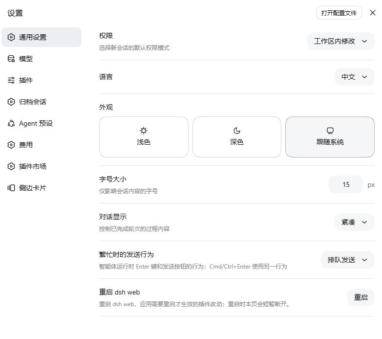

# dsh-simple-restart

English | [中文](README.zh.md)

[](https://github.com/deepseek-ai/deepseek-harness)
[](https://github.com/yizhixiaokong/dsh-simple-restart/actions/workflows/ci.yml)
[](LICENSE)
[](https://github.com/topics/dsh-plugin)

A [DeepSeek Harness](https://github.com/deepseek-ai/deepseek-harness) plugin
that adds one row to **Settings → General**: a button that restarts the running
`dsh web` process with the same invocation it was started with.

It exists because a plugin change to a client bundle only takes effect after the
host restarts, and doing that from a terminal means finding the terminal again.
This package owns its own route and its own restart logic — no other plugin is
involved.

## Screenshots

The row in Settings → General.



A second click within 5s confirms; the hint line then reports the host pid
stepping aside and the helper's pid.


## What it does

1. The row asks this package's own host route for a restart (a second click
   confirms; the armed state expires after 5s).
2. The host checks its own safety rules, and picks one of two ways to restart.
3. **A unit that restarts on any exit** (`Restart=always`): the restart *is* the
   exit. The host answers `202`, waits `selfExitDelayMs`, and signals itself;
   the unit starts the replacement. Nothing is spawned detached, so
   `KillMode=control-group` has nothing to kill and no privileges are involved.
   Taken only when this process is the unit's `MainPID` — the process systemd
   restarts — and `RestartPreventExitStatus=` does not list `SIGTERM`, since
   that property overrides `Restart=` and the exit would leave nothing running.
4. **Otherwise**, the host spawns a **detached helper** and hands it the exact
   boot invocation — executable, argv, working directory. The helper waits until
   the listening port is free, starts the replacement, and watches for up to 20s
   to confirm it bound the port. The host exits 500ms after the handoff.
5. Either way the browser page disconnects briefly and reconnects when the new
   process is up.

If anything goes wrong after the handoff, the helper writes a diagnosis to
`$TMPDIR/dsh-simple-restart-<timestamp>.err.log` (the replacement's own stdout/stderr
go to the `.out.log` beside it). The process that would otherwise log the
failure is the one that just exited — that is why the helper is a separate
program rather than a `setTimeout` in the host.

## Why a helper at all

A process cannot replace itself: it can only stop, and something has to start the
successor *after* the listening port is free. Starting it earlier dies with
`EADDRINUSE`. So the restart is a handshake between two processes, and the second
one has to be detached — it must outlive the first.

`"free"` is tested by *connecting* to the port, never by binding it: a test bind
would itself hold the port at the exact moment the replacement needs it.

## Requirements

| Requirement | Notes |
| --- | --- |
| DSH, web profile | The route is served by `webServer`; the settings row is a client-half slot. |
| Same-origin loopback caller | The route refuses anything else (see below). |
| Not supervised by systemd — or the unit restarts on any exit — or `allowRestart: true` | Under systemd's default `KillMode=control-group` a detached helper dies with the unit, so a restart there would leave nothing running. Two supervised shapes still work: a unit with `Restart=always`, where the restart becomes the exit itself (only when this process is the unit's `MainPID` and `RestartPreventExitStatus=` does not cover `SIGTERM`), and an explicit `allowRestart: true` for a unit configured to survive the helper (`KillMode=process`). |
| Not under a debugger | A debugger attached to this process cannot follow it across an `exec`-less restart. |

## Install

Straight from GitHub — nothing to clone (pin a tag if you want a fixed release):

```sh
dsh plugin --profile web add "github:yizhixiaokong/dsh-simple-restart"
# pinned: dsh plugin --profile web add "github:yizhixiaokong/dsh-simple-restart#v0.1.1"
```

From a clone, when you want to edit the code:

```sh
git clone https://github.com/yizhixiaokong/dsh-simple-restart.git
cd dsh-simple-restart
dsh plugin --profile web add "$PWD"
```

From npm:

```sh
dsh plugin --profile web add dsh-simple-restart
```

All three end the same way, and none of them needs a manual registration step:
`dsh plugin` runs pnpm, then reads each installed dependency's
`package.json`; a package that declares `dsh.bundle` has its name appended to
`dsh.profile.bundles`, which is what mounts the
[`cordis.patch.yml`](cordis.patch.yml) beside it.

**Now restart `dsh web` once from a terminal** — the client bundle is baselined
at boot, so the button appears only after the next start. After that, the
button can do it.

To remove it:

```sh
dsh plugin --profile web remove dsh-simple-restart
```

## Usage

Settings → **通用 / General** → *重启 dsh web*:

- first click arms the button (`确认重启？`), a second click within 5s performs it;
- the hint line then shows the host pid that is stepping aside and the helper's
  pid, plus the diagnostics path;
- the page reconnects on its own once the replacement is listening.

## Configuration

The row's config is passed to the host `apply`:

```yaml
# in the profile's cordis.patch.yml, on the row this package contributes
- insert:
    - id: simple-restart
      name: dsh-simple-restart
      config:
        # Leave this out on a unit with Restart=always: the host detects that
        # the unit starts it again on any exit and uses the self-exit path.
        allowRestart: true       # force the detached-helper path anyway
        selfExitDelayMs: 1500
```

| Key | Type | Default | Meaning |
| --- | --- | --- | --- |
| `allowRestart` | `boolean` | unset — decided per host | `false` refuses a restart outright; `true` forces the detached-helper path. Left unset, the host decides: no supervisor → helper; a detected supervisor whose unit has `Restart=always`, runs this process as its `MainPID`, and does not prevent a `SIGTERM` exit → self-exit; any other supervised shape → refuse. Only set `true` where the unit is known to survive a detached helper (`KillMode=process`). |
| `selfExitDelayMs` | `number` | `1500` | Milliseconds between the `202` answer and the self-exit signal, so the browser receives the receipt before the socket goes away. Used only on the self-exit path. |

## HTTP API

One exact route, `POST /dsh-simple-restart/api/restart`. It is fenced before anything is
spawned:

| Check | Refusal |
| --- | --- |
| Method other than POST | `405` with `Allow: POST` |
| Socket peer that is not `127.0.0.1`, `::1` or `::ffff:127.0.0.1` | `403` |
| Any forwarding header (`forwarded`, `x-forwarded-for`, `x-real-ip`) | `403` |
| Missing `Origin`, or an `Origin` whose host is not `Host` | `403` |
| `allowRestart: false` | `403` |
| systemd supervisor detected, and the unit either does not restart a `SIGTERM` exit (`Restart=` is not `always`, or `RestartPreventExitStatus=` covers `SIGTERM`) or does not run this process as its `MainPID`; overridden by `allowRestart: true` | `403` |
| Debugger detected in `process.execArgv` | `403` |
| A restart is already scheduled | `409` |

```jsonc
// 202 Accepted — "self-exit": the unit starts the replacement itself
{
  "ok": true,
  "mode": "self-exit",
  "pid": 12345,                // the host that is stepping aside
  "unit": "dsh-web.service",   // the unit that will start the replacement
  "signalMs": 1500             // how long the answer had before the signal
}

// 202 Accepted — "helper": the detached helper brings the replacement up
{
  "ok": true,
  "mode": "helper",
  "pid": 12345,          // the host that is stepping aside
  "helperPid": 12350,    // the detached helper
  "logOut": "/tmp/dsh-simple-restart-2026-09-15T10-00-00.out.log",
  "logErr": "/tmp/dsh-simple-restart-2026-09-15T10-00-00.err.log"
}
```

Failures answer `{"ok":false,"error":"…"}` with the status from the table above.

The helper is spawned as `node -e <program>`, detached with `stdio: "ignore"` and
`unref()`ed, so it is out of this process's lifetime from the moment it exists.
It is given the boot invocation as data (`{ file, args, cwd }`), never by
re-running a shell command line: when the host was started as `node …/bin.js`
the absolute entry and its original `execArgv`/argv are reused; otherwise it
falls back to the `dsh` executable on `PATH` with the original arguments.

## Limits and known behaviour

- **Detached, not supervised.** Once the helper is running, this package has no
  further control over it. A restart of a process started with unusual wrapper
  arguments (a shell function, a container entrypoint) falls back to running
  `dsh` with the same argv — which is right for `dsh web`, not for every
  possible wrapper.
- **No port to wait for.** If `Host` carries no port, the helper simply waits
  1.5s before starting the replacement.
- **Only `Restart=always` counts as a supervisor that restarts.** `on-failure`,
  `on-abnormal` and `on-success` do not restart a process that exited cleanly —
  which is what a signal produces — so those units are refused rather than left
  dead. `RestartPreventExitStatus=` overrides `Restart=`, so a unit that lists
  `SIGTERM` there is refused too, and the self-exit is only taken when this
  process is the unit's `MainPID`: systemd restarts that process, not a child.
- **Environment is inherited**, including the current working directory.
- **Diagnostics live in the temp directory** and are never cleaned up; they are
  small, and finding them is the point.

## Development

```
lib/index.js        host half — route, guards, supervisor decision table, launch
                    description, detached helper
lib/client.js       client bundle — one General-settings row
cordis.patch.yml    the single host row this package contributes
scripts/smoke.mjs   offline checks (no harness, no restart)
```

```sh
npm test          # node scripts/smoke.mjs
```

The smoke test materializes the client bundle against stub globals and applies
the host half to a stub context. **It never restarts anything.** It checks that
the client half fills exactly one settings seat, that the host registers exactly
one route, and that both halves agree on that route's path — a mismatch shows up
in the browser as a row that always says "请求失败" while the host log stays
empty. It also runs the supervisor decision table offline: which restart a
supervised host gets, and the shapes that are still refused.

## Repository notes

Versions are tagged to match `package.json` — this tree is `v0.1.1`.

The `yizhixiaokong` placeholder in `package.json`, `CHANGELOG.md`, the badges and the
install commands above stands for the GitHub account this repository is pushed
to; replace it before publishing. The commits here were authored under a neutral
`dsh-plugins <noreply@example.com>` identity so that no personal address ends up
in the published history; if you want your own name on them, set
`git config user.name` / `user.email` and run
`git commit --amend --reset-author` before pushing.

### About the name

This plugin was developed under the working name `dsh-restart-button`. That name
is not available: it is published on npm by
[`jiqiu0709/dsh-restart-button`](https://github.com/jiqiu0709/dsh-restart-button)
and used by several other GitHub repositories, so the package ships as
`dsh-simple-restart`. Renaming also removed a real collision — the route is now
this package's own `/dsh-simple-restart/api/restart`, instead of the
`/dsh-restart/api/restart` that other restart plugins register.

### Getting listed in the marketplace

The plugin list at
[awesome-dsh-plugin](https://github.com/awesome-dsh-plugin/awesome-dsh-plugin)
is generated from one YAML file per plugin, and its CI checks a submission's
shape against this repository. The mechanical part is already satisfied here:
`dsh.bundle` is declared in `package.json` beside `cordis.patch.yml`, the
official `@deepseek-ai/*` packages are declared as `peerDependencies`, there are
no dependencies to install and no build step.

Mind what this plugin shares with entries already on that list: several of them
restart `dsh web` from inside the GUI. This one adds two things they do not
state — it refuses to restart under a detected systemd supervisor, whose default
`KillMode=control-group` would kill the helper along with the unit, and it tests
whether the port is free by *connecting* to it rather than binding it, so the
replacement never races the old process for the port.

Owner steps:

1. add the `dsh-plugin` topic —
   `gh repo edit yizhixiaokong/dsh-simple-restart --add-topic dsh-plugin`;
2. let the repository age past 1 day (the list's CI rejects younger ones);
3. open one PR adding `data/plugins/yizhixiaokong__dsh-simple-restart.yml`:

   ```yaml
   url: https://github.com/yizhixiaokong/dsh-simple-restart
   name: yizhixiaokong/dsh-simple-restart
   category: dev
   description:
     en: 'Adds a restart row to Settings → General that relaunches dsh web with the same invocation through a detached helper, refuses under a detected systemd supervisor unless allowRestart is true, and tests whether the listening port is free by connecting to it rather than binding it.'
     zh: '在「设置 → 通用」增加一行重启按钮：用相同启动参数、经分离的 helper 重新拉起 dsh web；检测到 systemd 监管时默认拒绝（除非 allowRestart 为 true）；判断端口是否空闲用连接探测而非绑定。'
   ```

The storefront reads a `screenshots.json` next to `package.json` for its
screenshot strip; this repository declares `assets/01-settings-row.png` and
`assets/02-confirm.png`, in that order.

### Publishing to npm

```sh
npm login --registry=https://registry.npmjs.org   # a mirror accepts neither a login nor a publish
npm publish --registry=https://registry.npmjs.org
```

`npm publish --dry-run` prints the tarball contents without uploading anything,
and `prepublishOnly` runs `npm test` before either. The published package's
`repository` field points back here; that is what lets the plugin list link the
two and then offer the registry install form instead of the GitHub one.

## License

[MIT](LICENSE)
